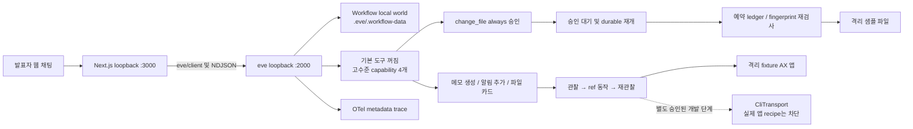

# 구조와 안전 경계

## 런타임

공식 `eve init`과 `eve add channel/web`의 Next.js 구조를 기반으로 합니다. Next.js와 eve를 별도 프로세스로 실행하고 웹의 `/eve/*`를 루프백 eve로 rewrite합니다. 이 방식은 백엔드를 `--no-default-extensions`로 확실히 실행하기 위해 선택했습니다. 모델은 웹 서버나 임의 shell에서 앱을 제어하지 않습니다.

세션은 Workflow SDK local world에 저장됩니다. 현재 버전의 공식 문서상 기본 위치는 `.eve/.workflow-data`이며, eve가 개발 generation·snapshot·trace도 `.eve/` 아래 관리합니다. 같은 프로젝트·같은 `.eve`를 유지한 채 `--resume`으로 재시작합니다. 개발 워커 교체는 같은 세션의 승인 interaction ID를 유지합니다. 이 로컬 저장소를 잃으면 복구를 보장할 수 없습니다. 고가용성이나 전원 장애 복구까지 검증한 것은 아닙니다.

## 모델 권한

`defaultTools:false`, `tool:false` 및 agent-wide allowlist로 네 도구만 허용합니다. 연결, shell, 파일 수정, 범용 desktop 명령, 자기 수정 확장과 하위 에이전트를 등록하지 않았습니다. 파일명이나 메모 내용의 prompt injection이 코드 권한을 추가할 수 없습니다.

- `write_note`: 신규 샘플 메모만 생성. 기존 메모 수정·삭제 없음.
- `add_reminder`: 신규 샘플 알림만 생성. ISO offset과 IANA time zone 필수.
- `latest_files`: marker가 있는 격리 fixture의 직접 자식 파일 최대 5개만 읽음.
- `change_file`: 정확한 파일·fingerprint·동작·고정 목적지에 대해 **매번** 승인.

`change_file`은 `always()`를 사용합니다. `auto()`나 `once()`로 승인을 생략하지 않습니다. 승인 대기 전에는 execute가 시작되지 않습니다. 거절하면 실행되지 않습니다. UI에서 버튼을 누른 직후에는 서버 확정 전까지 버튼을 잠급니다. 세션 재연결은 eve hook의 `initialSession`·`resume`을 사용합니다. 승인 권한은 eve의 동일 요청자 기본 정책을 따릅니다. 이 프로젝트는 로컬 단일 사용자 데모이며 별도 웹 로그인은 구성하지 않았습니다.

## Headless CLI 경계

`agent/lib/desktop.ts`는 shell 없이 인자 배열로 고정 로컬 CLI를 호출합니다. `snapshot --app <bundle-id> -i --window-id <pinned-id> --timeout-ms 5000`과 전체 ref의 `click`, `type --stdin`, `set-value --stdin`만 허용합니다. 텍스트를 프로세스 인자에 넣지 않습니다.

앱은 `com.apple.Notes`, `com.apple.reminders`, `com.apple.finder`로 선택합니다. 관찰 결과도 해당 앱의 번들 ID 또는 대응하는 영어 표시 이름인지 검사합니다. 다중 창은 운영자가 지정한 window ID가 필요합니다. 임의 후보를 선택하거나 표시 이름으로 느슨하게 재시도하지 않습니다. macOS 표시 이름·언어 차이는 네이티브 리허설에서 검증해야 합니다.

`--headed`, `press`, `focus`, `focus-window`, `launch`, `--activate`, 마우스 좌표, clipboard를 허용하지 않습니다. 특히 `press`는 기본 모드에서도 물리 키 입력이므로 사용할 수 없습니다. 실제 AX 호출이 앱 자체에서 불러오는 UI 효과까지 사전에 보장할 수 없어 네이티브 검증을 별도 단계로 남겼습니다.

## Ref 및 실패 복구

1. 매 동작 전에 새 snapshot을 읽고 `complete:true`를 확인합니다.
2. 정확한 role/name이 하나인지 검사하고 해당 snapshot 전체 ref를 선택합니다.
3. 동작 뒤 성공 여부와 관계없이 새 snapshot으로 결과를 확인합니다.
4. 관찰로 효과가 확인되면 성공으로 처리합니다. CLI `ok:true`만으로 성공을 판정하지 않습니다.
5. 효과가 확인되지 않은 `STALE_REF`, `AMBIGUOUS_TARGET`, `SNAPSHOT_NOT_FOUND`는 **`retry:safe`와 `delivery:not_delivered`가 모두 있을 때만**, 새 ref로 최대 한 번 재시도합니다.
6. 새 관찰에도 후보가 여럿이면 중단합니다. unsafe·unknown delivery는 읽기만 하고 동작을 반복하지 않습니다.

현재 한계: 비동기 효과의 장기 polling은 구현하지 않았습니다. 즉시 재관찰에서 효과가 안 보이면 보수적으로 중단할 수 있습니다. 시간 기반 sleep 후 클릭 재시도는 하지 않습니다.

## 중복과 파일 범위

부작용 전에 세션·종류·입력의 해시로 예약 ledger를 `wx` 생성하고 fsync합니다. 검증 완료된 같은 호출은 저장 결과를 반환합니다. started 상태나 읽기 실패는 결과 불명으로 멈춥니다. 프로세스 간 공용 lock은 앱 동작을 직렬화하며 stale lock을 자동 탈취하지 않습니다. 입력이나 세션을 바꿔 결과 불명을 우회하면 안 됩니다.

이 장치는 정확히 한 번의 부작용을 보장하는 분산 트랜잭션이 아닙니다. 전원 장애·저장소 손실·다른 사용자의 동시 변경은 별도 고려가 필요합니다. 불명 결과는 사람이 실제 상태를 확인하고 ledger를 조정해야 합니다.

파일은 marker가 있는 fixture 내부, 직접 자식의 일반 파일, 1MB 이하로 제한합니다. symlink·경로 이동·덮어쓰기를 거부합니다. 승인 후에도 내용·mtime·inode에서 계산한 fingerprint를 다시 검사합니다. Trash는 OS 휴지통이 아닌 샘플 하위 폴더이며, 공유는 로컬 JSON 미리보기입니다. 실제 외부 공유나 Finder UI 변경으로 설명하면 안 됩니다. 적대적인 로컬 프로세스의 TOCTOU 공격까지 방어하는 보안 sandbox는 아닙니다.

## 관측성

`agent/instrumentation/otel.ts`로 eve OTel을 구성합니다. `recordInputs:false`, `recordOutputs:false`여서 메모 본문·도구 인자·결과가 trace에 캡처되지 않습니다. 별도의 외부 exporter는 등록하지 않았습니다. eve 개발 trace에서 `invoke_agent`, `agent.step`, `chat`, `execute_tool`, `agent.approval`을 실제 확인했습니다. `eve traces --json`과 `eve traces list`로 조사할 수 있습니다.

OTel 본문 제외와 세션 재접속 기록은 별개입니다. 재개 시연을 위해 Workflow retention은 `default`로 명시했으며 `.eve`의 세션 내용과 `.demo`의 샘플 상태는 로컬 디스크에 남습니다. 공개 Git에는 포함하지 않습니다.

두 서버는 127.0.0.1에만 바인딩합니다. Next proxy는 외부 origin을 차단합니다. Workflow local world의 flow 엔드포인트는 배포용 인증 경계가 아닙니다. 인터넷에 포트를 노출하거나 이 구성으로 외부 배포하지 마세요. 실제 서비스에는 인증·세션 소유권·queue 인증과 별도의 macOS worker가 필요합니다.

프레임워크 workspace는 `JustBashSandbox.environment({autoInstall:false})`를 명시하여 Docker나 클라우드 sandbox 없이 로컬 빌드를 재현합니다. 이는 순수 JavaScript 가상 filesystem이며 macOS VM이 아닙니다. 모델에 bash/file 도구를 제공하지 않고 native 프로세스 실행에도 사용하지 않습니다.
